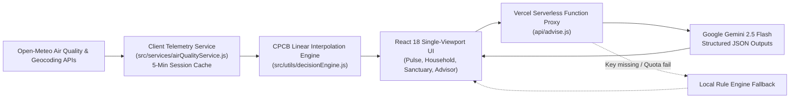

# AeroSense AI — Urban Air Quality Decision Assistant

[](https://vitest.dev/)
[](https://react.dev/)
[](https://vitejs.dev/)
[](https://aistudio.google.com/)
[](LICENSE)

> Built for **Hack2Skill Virtual Prompt Wars — Challenge 6: Urban Air Quality Assistant**.  
> **Live Deployment:** [https://aerosense-ai.vercel.app](https://aerosense-ai.vercel.app) *(Deploy URL Placeholder)*

---

## 🎯 Chosen Vertical & Challenge Scope
- **Challenge 6:** Urban Air Quality Decision Assistant.
- **Mission:** Transform raw, abstract atmospheric telemetry (PM2.5, PM10, AQI numbers) into immediate, physiological, and actionable household decisions for Indian urban families.

---

## 🛑 Problem Statement
Millions of urban residents in Indian cities (Hyderabad, Delhi, Mumbai, Bengaluru, etc.) check generic weather or air quality apps daily. However, existing consumer apps suffer from severe practical deficiencies:
1. **Abstract Numbers without Context:** Telling an asthmatic senior or parent that the AQI is "185" fails to answer: *"Can my child attend outdoor soccer practice at 8 AM?"* or *"When should I open my apartment windows?"*
2. **Formula Disconnect:** Most global platforms default to the US EPA AQI scale, which uses different particulate concentration breakpoints than the official **Central Pollution Control Board (CPCB) India National Air Quality Index (NAQI)**.
3. **No Temporal Window Planning:** Air pollution is diurnal; morning thermal inversions trap surface exhaust while afternoon solar warming disperses smog. Citizens lack scrubbable intelligence identifying the cleanest 2-hour outdoor window.
4. **Data Hallucination & Security Risks:** Commercial AI chatbots often hallucinate numbers or expose paid API keys directly in client-side bundles.

---

## 👥 Target Users
- **Parents of School Children:** Deciding whether open-air morning school runs and playground drills are safe or require sealed bus transport and N95 masks.
- **Seniors & Asthmatic Individuals:** Requiring strict indoor containment guidance and scheduled balcony walks aligned with diurnal dispersion.
- **Urban Runners & Athletes:** Managing aerobic minute-ventilation loads to prevent microvascular inflammation.
- **Daily Commuters:** Identifying arterial corridor risks and tracking quantified carbon/particulate reductions by opting for Metro rail or carpooling.

---

## 🎨 Bespoke UI/UX Design Philosophy

AeroSense AI eschews generic dark dashboards and cluttered multi-column KPI grids in favor of a **tactile consumer hardware companion** inspired by **Dieter Rams / Braun functionalist precision instruments**:

- **"Cloud Dancer & Fired Clay" Palette:**
  - **Page Canvas:** `#F0EEE9` (Cloud Dancer warm off-white)
  - **Card Surfaces:** `#FAF9F6` (Alabaster) with `1px solid #DFDDD6` hairline borders and zero heavy drop shadows.
  - **Primary Text:** `#18181B` (Obsidian Charcoal) and `#57534E` (Warm Limestone).
  - **Botanical Moss (`#2D5A27`):** Indicating safe atmospheric windows and active positive selections.
  - **Fired Terracotta Clay (`#C84B31`):** Highlighting critical inversion smog warnings and alert modes.
- **Single-Viewport Layout (`100vh`):**
  - No vertical scroll clutter on desktop; each view fits in a single screen via an asymmetric split layout.
  - Sticky 64px Command Navbar with compact inline city search, segmented pill tabs (`role="tablist"`), and physical-feel toggle switches.
- **High-Contrast / Senior Vision Mode:**
  - One-tap header toggle sharpening card borders to `2px solid #000000`, boosting font scaling by `105%`, and elevating contrast for elder eyes.

---

## 🧭 Four Core Views & Signature Visual Instruments

```
┌──────────────────────────────────────────────────────────────────────────────────┐
│ [● AeroSense AI] [Search: Hyderabad ▾]  [ Pulse | Household | Sanctuary | Advisor ]  [Smog: 360] [Contrast] [↻] │
└──────────────────────────────────────────────────────────────────────────────────┘
```

### 1. `Pulse` View (60 / 40 Asymmetric Split)
- **Atmospheric Sky-Wash Concentric Dial (Left 60%):**
  - Displays **Indian CPCB AQI** and **US EPA AQI** side-by-side using `tabular-nums`.
  - Ambient radial sky-wash shifts naturally from soft botanical sage mist (clean) to warm parchment (moderate) to dusty terracotta clay (severe smog).
  - Identifies the dominant criteria pollutant (`PM2.5` or `PM10`) and presents 4 hardware criteria pollutant readings (`PM2.5`, `PM10`, `NO₂`, `O₃`) with WHO safe target baselines.
  - **10-Second Family Briefing:** Immediate natural-language synthesis summarizing daily air quality for fast decision-making.
- **24-Hour Clean-Window Scrubbable Ribbon (Right 40%):**
  - Interactive hourly PM2.5 waveform. Scrubbing or hovering over any hour updates a live micro-readout.
  - Highlights the cleanest 2-hour outdoor window in Botanical Moss with exposure reduction percentage vs. current air.

### 2. `Household` View (Personas & Physiological Budget)
- **Active Household Personas:** Multi-select family toggles (`School Child` 🎒, `Elderly / Asthma` 🫁, `Outdoor Runner` 🏃, `Daily Commuter` 🚗) combined with a Planned Activity selector (`School Run`, `Exercise`, `Commute`, `Ventilation`).
- **Daily PM2.5 Exposure Budget Arc:**
  - Animated SVG semicircular gauge calculating what percentage of the WHO recommended daily safe PM2.5 inhalation allowance ($180\ \mu\text{g}$) this activity consumes based on exertion minute ventilation.
- **Tailored Verdict Cards:** High-contrast `GO`, `MODIFY`, or `AVOID` directives with scientific rationale, safer window swaps, and indoor protection steps.

### 3. `Sanctuary` View (Home Defense & Sustainability)
- **Smart Window Ventilation Guide:** Diurnal breakdown of morning thermal inversion trapping (7–10 AM), solar convection flush windows, and evening traffic resuspension.
- **Interactive Particulate Barrier Checklist:** Toggleable verification steps (weatherstripping, microfiber damp mopping without dry brooming, active kitchen exhaust during frying, and dedicated overnight HEPA rooms).
- **Quantified Sustainable Swaps:** Commute distance selector (5–50 km) and transit mode (Metro, Carpool 3x, Electric Bus) showing avoided $\text{CO}_2$ (kg), prevented tailpipe/brake PM2.5 (g), daily tree absorption equivalent, and estimated petrol cost saved (₹).

### 4. `Advisor` View (Context-Injected Gemini AI)
- **Live Context Snapshot Rail (35%):** Displays the exact physical telemetry parameters (City, CPCB AQI, Dominant Pollutant, PM2.5, PM10, Clean Window, Personas) being piped to the AI.
- **Gemini AI Decision Companion (65%):**
  - 4 One-tap family scenario chips tailored to the current city.
  - Free-text prompt input.
  - Renders Gemini's output as a structured **Action Card** (`Verdict Badge`, `Direct Answer`, `Why It Matters`, `Safer Alternative`, `Indoor Action`).
  - Powered by `@google/genai` and `gemini-2.5-flash` with zero client-side API key exposure.

---

## ⚙️ Technical Architecture & Data Ingestion



### Official Indian CPCB NAQI Formulation
Sub-indices are computed using linear interpolation across official CPCB breakpoints:
$$I_p = \left[\frac{I_{hi} - I_{lo}}{B_{hi} - B_{lo}} \times (C_p - B_{lo})\right] + I_{lo}$$

$$\text{CPCB AQI} = \max\left(I_{\text{PM2.5}}, I_{\text{PM10}}\right)$$

$$\text{Dominant Pollutant} = \begin{cases} \text{PM2.5} & \text{if } I_{\text{PM2.5}} \ge I_{\text{PM10}} \\ \text{PM10} & \text{otherwise} \end{cases}$$

---

## 🔒 Security & Safe GenAI Integration
- **Zero API Key Exposure:** The frontend never handles `GEMINI_API_KEY`. All LLM calls pass through the serverless function [`api/advise.js`](file:///c:/Users/tsk_2/OneDrive/Desktop/VSCode/PromptWars6/AeroSense-AI/api/advise.js).
- **Vite Dev Middleware:** Local development uses an internal connect middleware in [`vite.config.js`](file:///c:/Users/tsk_2/OneDrive/Desktop/VSCode/PromptWars6/AeroSense-AI/vite.config.js) that routes `/api/advise` directly to the backend handler without requiring third-party proxies.
- **Strict Git Safety:** `.gitignore` excludes `node_modules/`, `dist/`, and all `.env*` files. Only [`.env.example`](file:///c:/Users/tsk_2/OneDrive/Desktop/VSCode/PromptWars6/AeroSense-AI/.env.example) is committed.
- **Graceful Deterministic Fallback:** If `GEMINI_API_KEY` is not set or network quota fails, `/api/advise` returns HTTP 503 with `{ fallback: true }`, causing the UI to generate a grounded fallback card badged with `"Deterministic Rule Engine Fallback"`. The app never crashes.

---

## ♿ Accessibility & Inclusivity
- **WCAG 2.1 AA Compliant:** No information is conveyed by color alone. Every badge pairs accessible contrast with clear text and distinct icons (`ShieldCheck`, `AlertTriangle`, `XCircle`, `AlertOctagon`).
- **Screen Reader Announcements (`aria-live="polite"`):** Real-time updates for city changes, simulation toggles, and accessibility modes are broadcast to screen readers via an `.sr-only` region.
- **Visible Keyboard Focus:** Global `:focus-visible` outline (`2px solid #2D5A27` with `2px` offset) across all interactive tabs, search boxes, and buttons.
- **High-Contrast / Senior Vision Mode:** Darkens surfaces, sharpens borders to solid hairline ink, and increases base typography scale.

---

## 🧪 Automated Testing Suite (Vitest)

AeroSense AI includes a comprehensive unit test suite in [`src/utils/decisionEngine.test.js`](file:///c:/Users/tsk_2/OneDrive/Desktop/VSCode/PromptWars6/AeroSense-AI/src/utils/decisionEngine.test.js) validating:
1. Indian CPCB AQI sub-index calculations and category boundaries across PM2.5/PM10 concentrations corresponding to $\sim 30$, $80$, $130$, $220$, and $350\ \mu\text{g/m}^3$.
2. Dominant pollutant detection (`PM2.5` vs `PM10`).
3. 24h Clean-Window sliding 2-hour minimum search, average PM2.5 calculation, and exposure reduction percentages.
4. Household decision generation verifying stricter `AVOID` verdicts for vulnerable profiles (*School Child*, *Elderly / Asthma*, *Outdoor Runner*) under severe smog compared to good air.
5. Quantified sustainable mobility offset formulas.
6. Daily PM2.5 exposure budget arc calculations under clean and smog conditions.

```bash
# Execute unit test suite
npm test
```

**Results:**
```
✓ src/utils/decisionEngine.test.js (14 tests)
Test Files  1 passed (1)
Tests       14 passed (14)
Duration    ~700ms
```

---

## 🚀 Setup & Execution Instructions

### Prerequisites
- Node.js $\ge 18.0$
- npm $\ge 9.0$

### 1. Clone & Install
```bash
git clone https://github.com/tanmayi737/AeroSense-AI.git
cd AeroSense-AI
npm install
```

### 2. Configure Environment (Optional for Live GenAI)
```bash
cp .env.example .env.local
# Add your Gemini API key in .env.local:
# GEMINI_API_KEY=AIzaSy...
```
*(Note: If `GEMINI_API_KEY` is not provided, the app will seamlessly utilize its built-in local deterministic rule engine without throwing errors.)*

### 3. Start Development Server
```bash
npm run dev
```
Open [http://localhost:5173](http://localhost:5173) in your browser.

### 4. Build Production Bundle
```bash
npm run build
```

---

## 📌 Assumptions & Disclaimers
1. **Medical Advisory:** AeroSense AI provides preventive environmental health and exposure reduction guidance; it does not issue clinical diagnoses or drug prescriptions.
2. **Atmospheric Data:** Ambient telemetry is sourced from Open-Meteo's hourly weather and Copernicus atmospheric models. Microclimates adjacent to construction sites or high-traffic intersections may experience localized spikes.
3. **Simulation Mode:** The *"Simulate Smog (360)"* button injects a synthetic severe winter temperature inversion event ($360\ \text{AQI}, 210\ \mu\text{g/m}^3\ \text{PM2.5}$) designed specifically for evaluators to stress-test emergency advisories anytime.

---

## 📜 License
Distributed under the MIT License. Built with passion for **Hack2Skill Virtual Prompt Wars 2026**.
